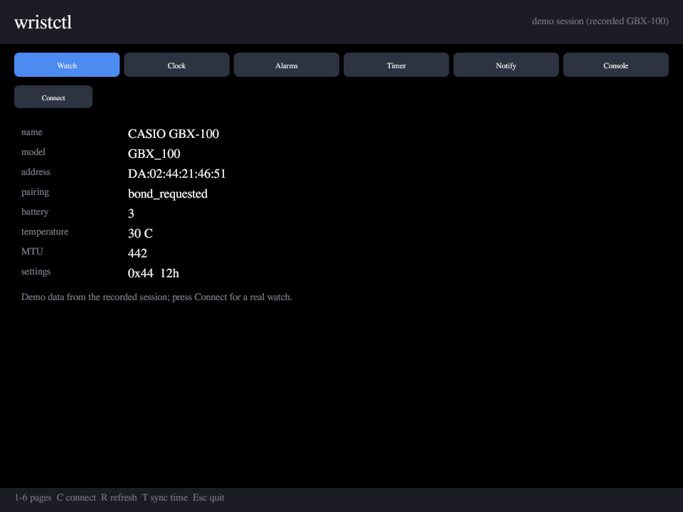
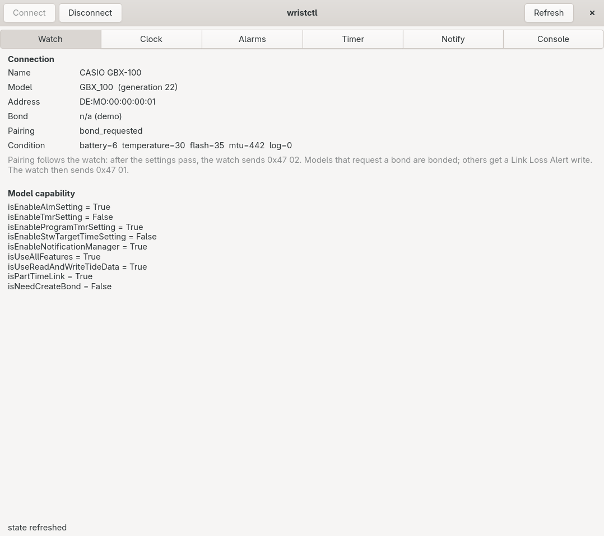
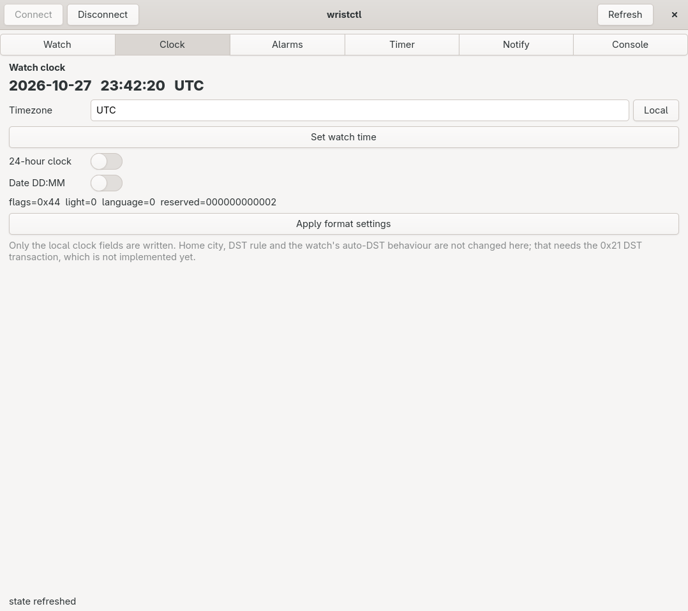
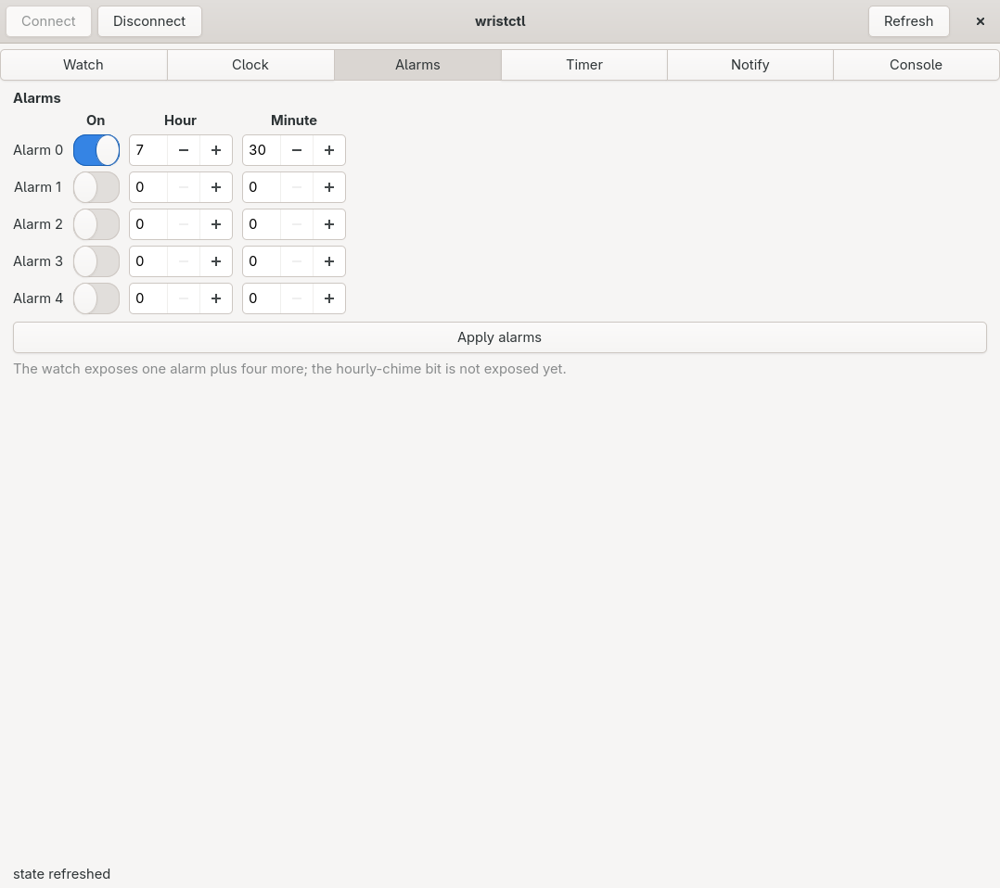
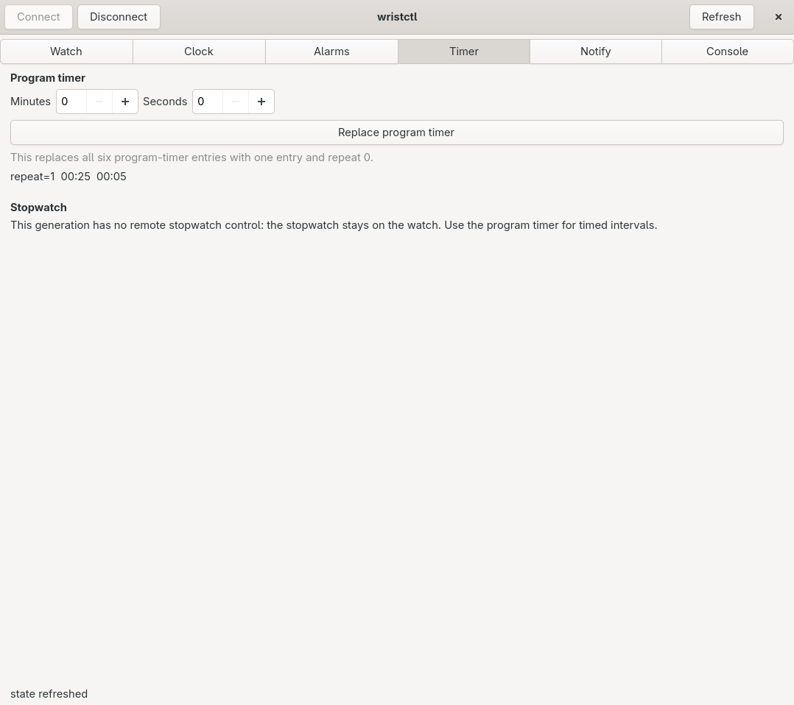

# wristctl

A free-software replacement for the CASIO G-SHOCK MOVE watch-control stack.
The wire protocol is described once in
`libs/firstparty/wristctl_core/spec/`, and the Python and C codecs are
generated from that description.

Status: **C11 protocol core, shared C++ desktop/Android GUI, GTK prototype**.
The Python tree remains the reference implementation and hardware harness. The
GUI covers watch status, clocks, alarms, timers, phone notifications and local
settings; unsupported official-app services are reported as unavailable rather
than simulated. Desktop pairing, state reads and a local-time write have been
verified on a GBX-100. Android has also been exercised with that watch, but the
newer SNTP, notification and phone-finder paths still need device validation.

The app is offline-first: no Casio account, cloud sync, Play Store integration,
analytics, telemetry or online coaching. Optional SNTP UDP time synchronization
is the only intentional network access. Firmware update remains out of scope.

## What is validated

`./scripts/build.sh test` (or `make test`) regenerates every codec and runs the
same 22 golden vectors through both implementations:

- 137 watch models, 37 protocol generations, 107 capability flags extracted
  from the vendor app's `CasioLibUtil.DeviceType` table
- 13 frame classes covering the connection handshake and the settings that were
  proven on a GBX-100: time, basic settings, five alarms, program timer, watch
  name, watch condition, DST state/setting, city name, app info, service
  discovery and error frames
- 5 core CTest suites (13 when the GUI and its tests are built), 43 Python tests
  and 19 builder tests, all passing
- C session pairing verified on a fresh GBX-100: time before `0x47 02`, SMP,
  `0x47 01`, bonded reconnect and settings read; reset alarm/timer frames
  captured and decoded

The Android app (`android/`) compiles those same C sources into
`libwristctl.so`, so the codecs under test are the codecs that ship.

The vectors come from the recorded HCI session and the hardware probes in
`../GSHOCK_DECOMP/work/`; derived vectors say so in their `source` field.

## Layout

```
libs/firstparty/wristctl_core/
  spec/classes.json      frame layouts (the source of truth)
  spec/models.json       generated model/capability registry
  spec/vectors/*.json    golden vectors, shared by Python and C
  gen/                   extractors and generators
  include/ src/ tests/   C11 core: codecs, model registry, session state machine
libs/firstparty/framework/   App_shell + Vk_Canvas submodules (GUI)
libs/firstparty/archive_engine/  arc_fs/arc_util for GUI paths (submodule)
platform/linux/          BlueZ transport over sd-bus (C11)
gui/                     App_shell/Vk_Canvas desktop frontend (C++17)
py/                      Python reference implementation (prototype) + GTK app
android/                 single-activity app; links wristctl_core over JNI
tools/                   capture decoder, vector authoring, hardware probe
scripts/                 build tool (manifest-driven cmake/ninja wrapper)
manifest.json            version and build entry used by scripts/build.sh
```

Build output is one `build/` root with one directory per variant:
`build/linux_debug`, `build/linux` (portable Release), `build/linux_native`
(`-march=native`) and `build/linux_custom-<arch>[_debug]`.

Generated files are `py/wristctl_proto/generated/*`,
`libs/firstparty/wristctl_core/include/wristctl/{generated,models}.h`,
`libs/firstparty/wristctl_core/src/{generated,models}.c` and
`libs/firstparty/wristctl_core/tests/generated_vectors.h`.
`include/wristctl/session.h` and `src/session.c` are hand-written.
Edit the spec, not the generated files.

## Commands

```sh
./scripts/build.sh                    # menu on a terminal; Debug otherwise
./scripts/build.sh build --debug      # build/linux_debug (tests + GUI if available)
./scripts/build.sh build --release    # build/linux (portable Release)
./scripts/build.sh build --release --arch native   # build/linux_native
./scripts/build.sh test               # regenerate + Debug + CTest + Python suites
./scripts/build.sh build --dry-run    # print the cmake commands, run nothing
./scripts/build.sh --version

make test        # same as ./scripts/build.sh test
make test-tool   # the builder's own 19 unit tests (no toolchain)
make build       # ./scripts/build.sh build --debug
make generate    # regenerate only
python3 tools/decode_capture.py   # coverage report against the recorded handshake
python3 tools/make_vectors.py     # rewrite the core's spec/vectors from the authored list

make gui         # build/linux_debug with the GUI, then run it (auto-connect)
make gui-live    # same, then force an immediate scan (--connect)
make ui-demo     # GTK prototype against the recorded session
make ui          # GTK prototype against a real watch

make android          # build app/build/outputs/apk/debug/app-debug.apk
make android-install  # build, then adb install
make android-lint     # lintDebug
```

The builder probes for the GUI's prerequisites (`slangc`, `glslc`, the
Wayland/xkb development files and the submodule checkouts) and enables
`WRISTCTL_BUILD_GUI` by itself when they are present; `--gui`/`--no-gui`
override that. Debug builds include the tests; Release builds do not. The
binary is `build/linux_debug/platform/linux/wristctl_cli` and the GUI is
`build/linux_debug/gui/wristctl_gui`.

The GUI needs a Vulkan SDK (`vulkaninfo`, `glslc`, `slangc`) and the
Wayland/xkb development packages. The framework libraries are submodules:

```sh
git submodule update --init --recursive
```

Details and page status are in `gui/README.md`.

The Android build needs JDK 17+, SDK 36 and NDK 29.0.14206865;
`android/local.properties` holds the SDK path on this machine. Details and the
native-activity migration notes are in `android/README.md`.

Tests need Python 3.10+, a C11 compiler and a C++17 compiler (the C++ consumer
test proves the headers are usable from C++).

### C++ GUI

`gui/` is the App_shell + Vk_Canvas frontend. It needs the Vulkan SDK
(`vulkaninfo`, `glslc`, `slangc`) and the Wayland/xkb development packages, and
it renders with the `assets/fonts` submodule (`ui/ui.otf` copied beside the
binary):

```sh
git submodule update --init --recursive
./scripts/build.sh build --debug --gui   # -> build/linux_debug/gui/wristctl_gui
./build/linux_debug/gui/wristctl_gui
make gui          # the same build, then run it
make gui-live     # same, then force an immediate scan
```

The GUI connects automatically on launch. It scans in 10-second windows and
retries with a 2-15-second backoff; `--no-connect` starts on the recorded demo
instead, and `Disconnect`/`C` turn auto-connect off and on. A dropped link is
detected through BlueZ and reconnected without user action. Closing the window
cancels an in-flight scan. Details are in `gui/README.md`.

**Sync time** uses device-local time or SNTP UTC. Pass `--timezone Etc/GMT+5`
(or set `WRISTCTL_TIMEZONE`) for local mode when the host zone differs from the
watch's. SNTP uses the Linux host's configured pool by default, runs identically
in the shared Android worker, and never changes the phone's system clock.

The worker thread owns the platform link and C session, so the window never
blocks on D-Bus or JNI. Five primary destinations cover Overview, Time, Alarms,
Timer and Phone, with Watch, Settings and Diagnostics in the utility area.
Desktop uses a slim navigation rail; Android uses bottom navigation. Supported
editors include alarms, the program timer, five cities/DST entries, basic
settings, watch name and app notifications. Overview card visibility now lives
in Settings, while raw frames, flags, logs and SNTP details live in Diagnostics.
Android adds opt-in, locally filtered notification forwarding and phone finder;
`gui/README.md` and `android/README.md` describe the readback, privacy and
validation rules. Newer writes still require hardware validation.



### GTK prototype and hardware probe

The Python app and the hardware probe need `bleak`; the app additionally needs
PyGObject/GTK4:

```sh
# Debian/Arch: install python-gobject and gtk4 first.
uv venv --system-site-packages --python 3.14 .venv
uv pip install --python .venv/bin/python bleak

make ui-demo                     # recorded session, no watch
make ui                          # real watch
PYTHONPATH=py .venv/bin/python -m wristctl_proto.ui --demo --screenshot /tmp/ui.png

PYTHONPATH=py .venv/bin/python tools/probe.py --scan
PYTHONPATH=py .venv/bin/python tools/probe.py --wait 90          # robust: scan by name
```

Scan by name rather than address. The GBX-100 regenerates its static random
address on power-up: it was `DA:02:44:21:46:51` during the October capture and
`EA:02:B4:35:46:51` later the same day. Bonding is per address, so a rotating
address also explains why the vendor app avoids mandatory bonding on this model.

The window has Watch / Clock / Alarms / Timer / Notify / Console pages. The
watch advertises briefly, so Connect keeps scanning for up to 90 s and asks you
to press a watch button.

| | |
|---|---|
|  |  |
|  |  |

`probe.py` connects, runs the identify/configure handshake, answers `0x47 02`
with a bond (or a Link Loss Alert write for models that use it), waits for
`0x47 01`, and prints the model, condition and bond state. It is read-only apart
from the app-info write and the pairing step.

## Spec schema

A class is a fixed-length frame whose first byte is the class id:

```json
{ "id": 9, "name": "current_time", "direction": "write",
  "confidence": "observed", "source": "…",
  "length": {"min": 11, "max": 11},
  "fields": [ {"name": "year", "type": "u16le", "offset": 1} ] }
```

Field types: `u8`, `i8`, `u16le`, `bcd8`, `bit` (a mask inside a `u8`
container), `bytes`, `string` (UTF-8, NUL-padded) and `array` (fixed count and
stride, item fields relative to the item).

A field with `"expected": N` is a constant: it is checked on decode, written on
encode, and omitted from both structs. Alarm separator bytes are deliberately
not fixed constants: the reset GBX-100 returns zero, so they remain ordinary
fields whose read values survive a write.

Bit fields do not replace their container: the container byte is preserved and
the bits are applied on top, so unknown bits survive a read-modify-write.

## Findings recorded while building this

- Capability flags are mostly **generation-wide**, not per model. `isEqualsModel()`
  compares the generation index, so `GBX-100` shares flags with `GBD-H1000`; only
  `this == MODEL` checks split a generation. Tide is the clearest example: it is
  `this == GBX_100` and applies to exactly one model.
- The vendor app identifies a model by **substring of the advertised BLE name**,
  longest alias first. That rule is implemented and tested in both languages.
- `0x24` is location and radio information, not home time. `0x2F` is the sensor
  setting, not time adjustment. `0x2E` is tide data. `0x3D` is the notification
  manager. `0x47` is watch-initiated and needs no reply.
- `0x1E` stores the timezone as a signed byte in 15-minute units and carries the
  watch's DST **rule index**, so `DST=AUTO` depends on the watch's own rule table.

## Next

1. Validate SNTP/UTC provisioning, notification delivery and phone finder on a
   physical Android phone and watch; builds and packet tests do not prove those
   device interactions.
2. Establish the complete activity/convoy download protocol before storing or
   displaying real activity history.
3. Establish run-measurement and GPS/radio-location framing before enabling
   those writes. The current UI leaves all three unavailable rather than sending
   placeholders or presenting fabricated data.
4. Add other remaining observed classes only after their field layouts are
   pinned down by captures or decompiled evidence.

Firmware update is deliberately out of scope: it needs vendor binaries and is
the only path that can brick a watch.

## Provenance and licensing

The spec is derived from a decompiled copy of `com.casio.gshockmove` 3.6.0 and
an HCI capture of the user's own watch. No Casio binary, firmware image, city
table or tide-harmonic asset is redistributed here. The model and flag names are
factual identifiers needed for interoperability.

## Consuming the core

The library is a normal CMake subdirectory. A parent project (for example
Klend-ario, as `libs/firstparty/wristctl`) does:

```cmake
set(WRISTCTL_BUILD_TESTS OFF CACHE BOOL "" FORCE)
add_subdirectory(libs/firstparty/wristctl wristctl_build)
target_link_libraries(consumer PRIVATE wristctl_core::wristctl_core)
```

`WRISTCTL_BUILD_GUI` defaults to OFF, so the parent needs no Vulkan, Wayland or
font toolchain to build the codecs. The generated C sources are committed, so
the parent never runs Python.

## License

AGPL-3.0; see `LICENSE`. Framework components and their terms are listed in
`THIRD_PARTY.md`.
